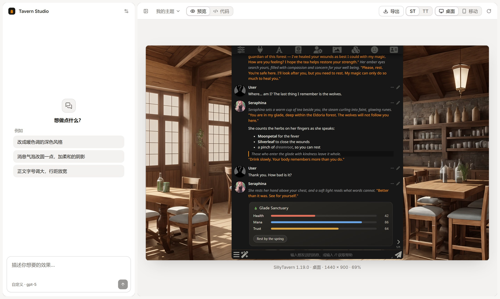

# Tavern Studio

在浏览器里给 SillyTavern 和 TauriTavern 做主题和扩展。改一行，就能在真正的酒馆界面里看到效果；也可以把想要的样子说给 AI 听，让它来改。

**打开就能用：<https://studio.tauritavern.com>**



## 能做什么

- **做主题**：配色、字体、消息气泡……改完立刻出现在右边的 SillyTavern 上，不用刷新。
- **做扩展**：从模板开始写一个 SillyTavern 扩展，边写边在预览里试。
- **两个前端随时切换**：同一个作品可以放在 SillyTavern 和 TauriTavern 里看，也能切到手机尺寸。
- **让 AI 帮忙**：接上你自己的模型，说一句"改成暖色调的深色风格"，它会自己改文件、看预览、一直调到合适。
- **带走成果**：主题导出成 SillyTavern 能直接导入的文件，扩展导出成 zip；整个项目也能打包备份，在别处再导入。

前端卡、酒馆助手脚本这些还在做。

## 用之前要知道

- **东西都在你自己的浏览器里**：没有账号，项目和对话不会上传到任何服务器。换浏览器、清理网站数据都会让它们消失，重要的项目记得导出。
- **AI 用你自己的 Key**：支持 OpenAI、Anthropic、Gemini、DeepSeek、OpenRouter，以及任何 OpenAI 兼容的接口。请求由浏览器直接发给服务商，不经过我们，所以服务商得允许浏览器直接访问。
- **Key 默认不保存**：关掉页面就忘了。勾选"记住"之后，预览里运行的扩展和卡片也能读到它，建议用有额度上限的 Key。
- **浏览器**：推荐电脑上的 Chrome 或 Edge，Firefox 也能用。Safari 和手机浏览器还没仔细测过。
- **还在早期**：功能在陆续补，难免有 bug，欢迎提 [issue](https://github.com/Darkatse/TavernStudio/issues)。

## 自己跑起来

需要 Node 24 以上和 pnpm 11。

```bash
pnpm install
pnpm vendor:st 1.19.0
pnpm vendor:tt
pnpm dev
```

`vendor:st` 和 `vendor:tt` 准备预览要用的 SillyTavern 和 TauriTavern，第一次需要联网。然后打开 <http://localhost:3000>。

提交之前跑一遍 `pnpm run check`，它会做类型检查、lint、格式检查、测试和构建。

另外几条用得上的命令：

- `pnpm knowledge --tt-checkout <TauriTavern 仓库目录>`：生成 AI 查资料用的知识包。不生成也能用，只是 AI 知道的少一些。
- `pnpm vendor:tt <TauriTavern 仓库目录> <提交>`：用本地的 TauriTavern 代码构建预览，同时改两边时用。
- 线上站点由 GitHub Actions 里的 Deploy 工作流发布到 Cloudflare，需要手动运行。

想深入了解，从 [docs/README.md](docs/README.md) 开始；参与开发前先读 [AGENTS.md](AGENTS.md)。

## 许可

AGPL-3.0-only。网站的设置里有"源代码"一项，指向当前版本对应的代码。

知识包里收录了 PolyForm Noncommercial 许可的内容（比如酒馆助手的文档），所以 Tavern Studio 只用于非商业用途，详见 [docs/Knowledge.md](docs/Knowledge.md#4-许可)。
